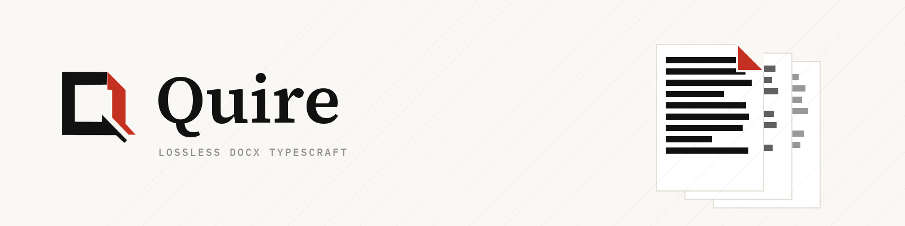

  

# Quire Office

**Lossless Office document engines in Rust.**

Office documents are the world's most portable data format — and the least respected.
Round-trip a real-world `.docx` through most open tools and you silently lose the parts
they don't understand. We build engines where that is structurally impossible: parts the
engine doesn't modify are re-emitted untouched, verified byte-for-byte by a CI gate on
every push. When the engine *does* edit a document, the guarantee shifts to structural
losslessness — every part still parses, nothing silently disappears.

## Products

| Project | Format | Status | What it is |
|---|---|---|---|
| **quire** | DOCX | private preview | Rust typesetting engine: lossless OPC round-trip (130/130 corpus files byte-identical in CI), Knuth-Plass line breaking, incremental pagination, native + wasm from one core |

XLSX and PPTX join the family as sibling format crates sharing what Office formats
actually have in common: the OPC container, OOXML part handling, and the same lossless
discipline — each with the layout model its format demands (flow, grid, or canvas).

## What we optimize for

- **Lossless by construction** — untouched parts are re-emitted byte-for-byte (CI-gated); edited parts stay structurally complete. Two distinct guarantees, honestly labeled.
- **One core, two shells** — the engine is one Rust codebase compiled for native and `wasm32-unknown-unknown`; shells are thin platform adapters, and the boundary is machine-enforced.
- **Cross-platform is the baseline** — the same gates run on Linux, macOS and Windows: formatting, clippy, tests, wasm link, bundle-size ceiling, round-trip.

## Where we are

DOCX parsing, lossless round-trip, line breaking (Latin + CJK), pagination and a
display-list render contract are green. Tables are in progress; headers/footers,
columns and tracked changes are next on the board. The repository is currently
private while the foundation firms up — it opens when the foundations are solid.

## About this org

Everything here is built to one standard: **a document that goes in must come out the
same document** — and line breaking that runs in a browser tab must be the same
computation that runs on desktop: one engine, one answer, per target platform.

<!-- website placeholder: add links to quireoffice.dev + docs here once the domain is live -->
